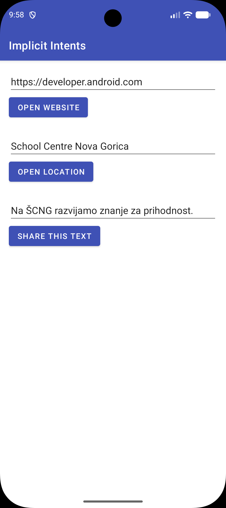
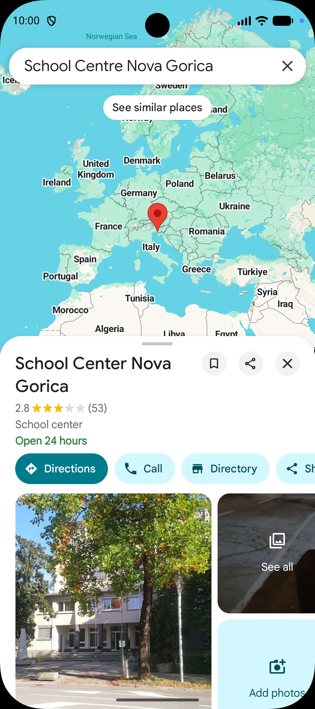
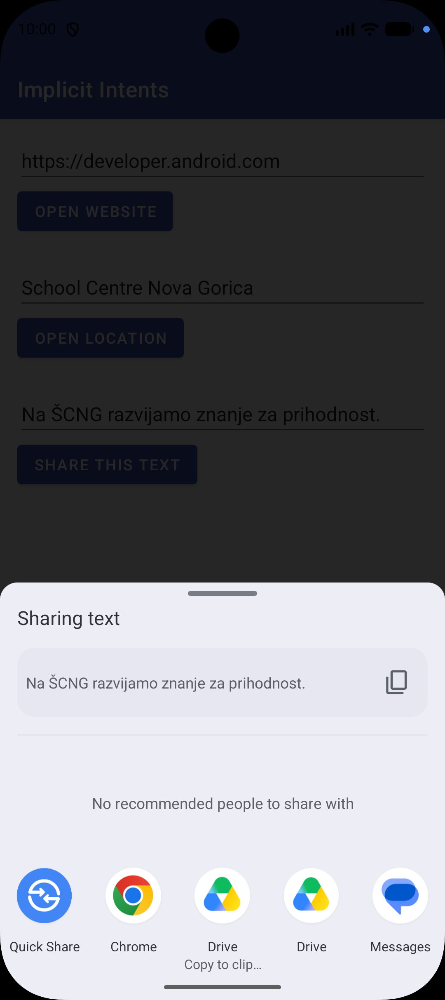

# Implicit Intents

Aplikacija, ki z implicitnimi nameni odpre spletno stran, prikaže lokacijo na zemljevidu, deli besedilo z drugimi aplikacijami in pokliče telefonsko številko, v Android Studiu.

## Funkcionalnosti

- **MaterialToolbar** z modrim ozadjem in belim naslovom »Implicit Intents«
- **LinearLayout** z navpično usmerjenostjo, v katerem so štirje pari vnosnega polja in gumba
- **EditText** s spletnim naslovom in **Button** »Open Website«, ki naslov pretvori v `Uri` in ga odpre z namenom `Intent.ACTION_VIEW`
- **EditText** z imenom lokacije in **Button** »Open Location«, ki sestavi URI v obliki `geo:0,0?q=lokacija` in lokacijo prikaže na zemljevidu
- **EditText** z besedilom in **Button** »Share This Text«, ki besedilo deli z razredom `ShareCompat.IntentBuilder` in MIME tipom `text/plain`
- **EditText** za telefonsko številko in **Button** »Call«, ki številko prebere z `getText().toString()`, jo z `Uri.parse("tel:" + številka)` pretvori v URI in z namenom `Intent.ACTION_DIAL` odpre klicalnik (dovoljenje `CALL_PHONE` ni potrebno)
- Pred zagonom namena se z `resolveActivity()` preveri, ali ga zna obdelati katera od aplikacij; če je ni, se prikaže Toast sporočilo
- V `AndroidManifest.xml` je zapis `<queries>`, da `resolveActivity()` na Androidu 11 in novejših vidi brskalnik in zemljevid
- **ReceiverActivity** z zapisom `intent-filter` (akcija VIEW, kategoriji DEFAULT in BROWSABLE, gostitelj developer.android.com), ki sprejme povezavo in prejeti URI, pridobljen z `getIntent().getData()`, prikaže v **TextView**
- Lastna **ikona aplikacije** (prilagodljiva vektorska ikona: bela puščica »odpri v drugi aplikaciji« na modrem ozadju)
- Vsa besedila so v datoteki `strings.xml`

## Posnetki zaslona

  
  &nbsp;&nbsp;&nbsp;
  
  &nbsp;&nbsp;&nbsp;
  
  &nbsp;&nbsp;&nbsp;
  

